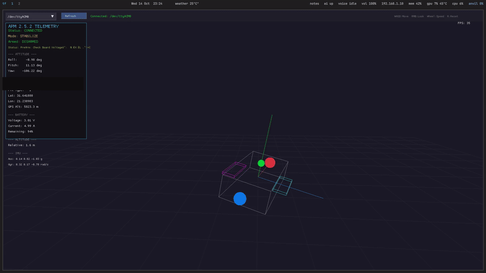

# APM 2.5.2 Visualizer

[](./LICENSE)

Live 3D telemetry visualizer for an **APM 2.5.2 flight controller**. No MAVProxy or
intermediate forwarder is required — the app talks MAVLink v1 directly to the
board over USB at 115 200 baud and renders craft attitude over a grid alongside a
full telemetry panel.




## Features

- **Direct serial telemetry** — reads `/dev/ttyACM*`, `/dev/ttyUSB*` or `COM*`
  ports with no proxy hop.
- **Live 3D craft** mirroring roll/pitch/yaw over a reference grid.
- **Telemetry panel** — attitude, GPS, battery, altitude, IMU and status.
- **Runtime port switching** — dropdown plus **Refresh** re-scans ports without
  restarting the app.
- **Stale-data detection** — telemetry flags `NO DATA` after 3 s without updates.
- **Non-commanding by design** — visualizes telemetry only; it never arms,
  configures, or commands the flight controller.

## Stack

- **Rust** (2021 edition)
- `macroquad 0.4` for rendering and windowing
- `mavlink 0.18` with the `dialect-ardupilotmega` feature
- `serialport 4` for direct port access

## Hardware & requirements

- An APM 2.5.2 flight controller on USB (typically `/dev/ttyACM0`)
- Serial-port access: user must be in the `uucp` group
- A running X11 or Wayland session (macroquad/OpenGL)
- Rust toolchain (`cargo`, `rustc`) — tested on Arch Linux

## Quick start

```bash
git clone git@github.com:GreenyZA/apm-visualizer.git
cd apm-visualizer
cargo build --release
./target/release/apm-visualizer
```

Or iterate while developing:

```bash
cargo run --release
```

## Controls

| Input | Action |
|---|---|
| `W` / `S` | Move camera forward / back |
| `A` / `D` | Move camera left / right |
| `Space` | Move camera up |
| `Left Shift` | Move camera down |
| Right mouse button (hold) | Look around |
| Mouse wheel | Adjust camera speed (0.5–20.0) |
| `R` | Reset camera |
| Port dropdown (top-left) | Select serial port |
| **Refresh** | Re-scan serial ports |

## Documentation

Full running manual (build, run, port selection, data flow, troubleshooting):

- [docs/index.md](docs/index.md)

## Troubleshooting

- No serial port appears → verify `ls /dev/ttyACM* /dev/ttyUSB*`, replug, click
  **Refresh**, and check `uucp` group membership.
- `Failed to open serial …` → another process holds the port, or permissions are
  wrong (`uucp` group).
- `NO DATA / stale` → confirm the controller is powered and running firmware;
  data streams are re-requested automatically.
- Nothing renders / GPU issues → confirm `DISPLAY`/`WAYLAND_DISPLAY`; macroquad
  needs OpenGL.

Rebuild from source at any time with:

```bash
cargo build --release
```

## Project notes

- Single-file application: [`src/main.rs`](src/main.rs).
- A legacy launcher script exists at `/home/warpuppy/run_visualizer.sh`; prefer
  the direct binary above.
- Visualization only — not a primary flight-safety instrument.

## License

Released under the [MIT License](./LICENSE).
